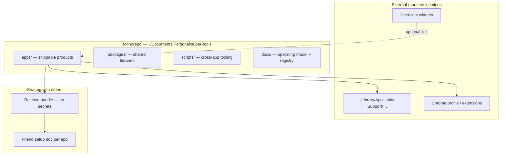

# Operating model — personal app portfolio

How we organize, build, maintain, and share apps across this workspace and related locations on your Mac.

---

## 1. Portfolio layers



| Layer | Path | Purpose |
|-------|------|---------|
| **Monorepo** | `/Users/zahidrasheed/Documents/Personal/super-tools` | Default home for extensions, Mac apps, shared packages |
| **Satellite** | Other paths (see [REGISTRY.md](./REGISTRY.md)) | Tools with their own install location (Übersicht, etc.) |
| **Runtime data** | `~/Library/Application Support/…` | User config, vaults, caches — never committed |
| **Exports / backups** | `exports/` in monorepo | Optional JSON exports; scrub secrets before sharing |
| **Settings backups** | `exports/backups/<timestamp>/` | Auto-created before clipper build/install (gitignored) |

### Back up settings before risky changes

Assistant Clipper stores vaults and preferences outside git:

```
~/Library/Application Support/Assistant/
  vaults.json
  clipper.json
```

Before installs or config edits, run:

```bash
bash scripts/backup-assistant-settings.sh
```

`apps/macos-secondbrain-clipper/scripts/build-app.sh` and `install.sh` run this automatically. Restore from `exports/backups/<timestamp>/` if needed.

---

## 2. What goes where

### Put in the monorepo (`Apps/`)

- Chrome extensions → `apps/<name>/`
- macOS apps → `apps/<name>/`
- Code shared by 2+ products → `packages/<name>/`
- One-off migration/setup scripts → `scripts/`
- Portfolio docs → `docs/`

### Put outside the monorepo

| Type | Why | Example |
|------|-----|---------|
| **Übersicht widgets** | Übersicht only loads from its widgets folder | See §3 |
| **Third-party plugin configs** | Owned by another app | Obsidian plugins, HA config |
| **Personal data** | Secrets, vault paths, API keys | `~/Library/Application Support/Assistant/` |

### Naming

- Folder names: lowercase, hyphenated (`macos-secondbrain-clipper`, not `MacOS Clipper`)
- Product display names: user-facing (`Summary`, `Assistant Clipper`)
- Shared packages: `@assistant/<name>` in `package.json` (JS) or Swift target `ClipCore`

---

## 3. Übersicht desktop widgets

**Übersicht** is a separate macOS app. Widgets must live where it expects them:

```
/Users/zahidrasheed/Library/Application Support/Übersicht/widgets/
```

When you ask to change **desktop widgets**, work in that folder (or in monorepo source if we add a deploy step — see below).

Current widgets (see registry): `FootballMatches`, `Countdown`, `home-assistant.jsx`, `screvi-remember.coffee`, etc.

### Recommended pattern (for sharing & git)

Keep **source** in monorepo, **deploy** to Übersicht:

```
apps/ubersicht-widgets/
  FootballMatches/
  Countdown/
  deploy.sh          # rsync or cp → Übersicht widgets folder
```

Until migrated, treat the Übersicht folder as **canonical runtime** and document widgets in [REGISTRY.md](./REGISTRY.md).

---

## 4. Monorepo layout (current)

```
Apps/
├── apps/
│   ├── chrome-summary/                 Chrome extension (Gemini summaries)
│   ├── chrome-supertools/              Chrome extension (small tools menu)
│   ├── macos-secondbrain-clipper/      macOS menu bar Obsidian clipper
│   ├── instagram-downloader/           Instagram download / saved sync
│   └── ESP32/                          AtomS3R firmware (PlatformIO)
├── packages/
│   └── clip-core/                      Shared clip format (JS) + tests
├── scripts/
│   ├── migrate-vaults.mjs
│   └── backup-assistant-settings.sh
├── docs/
│   ├── OPERATING_MODEL.md              ← this file
│   └── REGISTRY.md                     ← catalog of all projects
├── exports/                            Local backups (gitignore secrets)
├── package.json                        npm workspaces root
└── README.md                           Quick start per app
```

---

## 5. Development workflow

### Adding a new app

1. Add row to `docs/REGISTRY.md`
2. Create `apps/<name>/` with its own README section
3. If it shares logic with an existing app → extract to `packages/`
4. Add tests (unit at minimum for shared packages)
5. Update root `README.md` table

### Changing an app

1. Check **REGISTRY.md** for path and type
2. Run that app's tests before finishing
3. Bump version in manifest / Info.plist when shipping to yourself
4. Reinstall steps: extension reload, `install.sh`, or widget refresh in Übersicht

### AI / Cursor agent

- Read `docs/REGISTRY.md` first when the request mentions an app by name
- If more than one app could apply → **ask which app** before editing
- **Desktop widgets** → Übersicht path (§3)
- **Summary / extension** → `apps/chrome-summary/`
- **Supertools / copy all urls** → `apps/chrome-supertools/`
- **Clipper / Obsidian clip** → `apps/macos-secondbrain-clipper/`
- **Instagram download** → `apps/instagram-downloader/`
- **ESP32 / Atom / scale** → `apps/ESP32/`
- Do not commit API keys, vault paths, MQTT passwords, or `exports/` with personal data unless explicitly requested

---

## 6. Sharing with a friend

### Principles

| Do share | Do not share |
|----------|----------------|
| Source code (zip or git) | API keys, tokens |
| README + setup steps | Your Obsidian vault paths |
| Default/example config | `exports/` with your prompts |
| Build/install scripts | `~/Library/Application Support/…` files |

### Per product type

| Type | Friend receives | Friend does |
|------|-----------------|-------------|
| **Chrome extension** | `apps/<name>/` folder or release zip | Load unpacked in Chrome; add own API key in Options |
| **macOS app** | `.app` in zip or build from source | Copy to Applications; configure vaults in Settings |
| **Übersicht widget** | Widget folder | Copy into their `Übersicht/widgets/`; refresh Übersicht |
| **Shared package** | Included in monorepo | Usually not used alone |

### Release checklist (before sharing)

- [ ] Remove / redact secrets from code and sample configs
- [ ] `README` with install + minimum setup
- [ ] Version number bumped
- [ ] Tests pass (`npm test`, `swift test`, etc.)
- [ ] Optional: tag git release `summary-v2.0.0`, `clipper-v1.1.0`

### Future: GitHub

- One repo (`Apps`) with optional **release assets** per app
- Or split repos only when a friend needs a single app without the monorepo — prefer subtree or release zip first

---

## 7. Configuration boundaries

| App | Config location | In git? |
|-----|-----------------|---------|
| Summary | Chrome `storage.sync` | No |
| Assistant Clipper | `~/Library/Application Support/Assistant/` | No |
| Instagram downloader | App `.data/` / session under the app (see its README) | No (secrets) |
| ESP32 / AtomS3R | Device NVS + MQTT credentials (not in git) | No |
| Übersicht widgets | Often hardcoded in widget or local JSON | Source in git; personal URLs maybe not |

Use **export/import JSON** for portable settings (API keys excluded), like Summary settings export and vault migration script.

---

## 8. Testing strategy

| Scope | Command | When |
|-------|---------|------|
| JS shared packages | `npm test` (root) | Any change to `packages/` |
| Mac clipper | `cd apps/macos-secondbrain-clipper && swift test` | Clip format / writer changes |
| Chrome extension | Manual smoke test in Chrome | UI or background changes |
| Übersicht widgets | Refresh widget in Übersicht | After edit |

Add tests when adding shared logic — prevents regressions when new apps reuse packages.

---

## 9. Versioning

- **Chrome extension**: `manifest.json` → `version`
- **macOS app**: `Info.plist` → `CFBundleShortVersionString`
- **Widgets**: optional `version` in widget readme or comment
- **Monorepo**: no single version; each app versions independently

---

## 10. Decision log (template)

When we make a structural choice, add a line here:

| Date | Decision | Rationale |
|------|----------|-----------|
| 2026-06-27 | Monorepo at `~/Documents/Projects/Apps` | Summary + Clipper share clip format |
| 2026-06-27 | Split Summary (Chrome) vs Assistant Clipper (Mac) | Different runtimes & permissions |
| 2026-06-27 | Übersicht widgets stay in Application Support path | Übersicht requirement; registry documents them |
